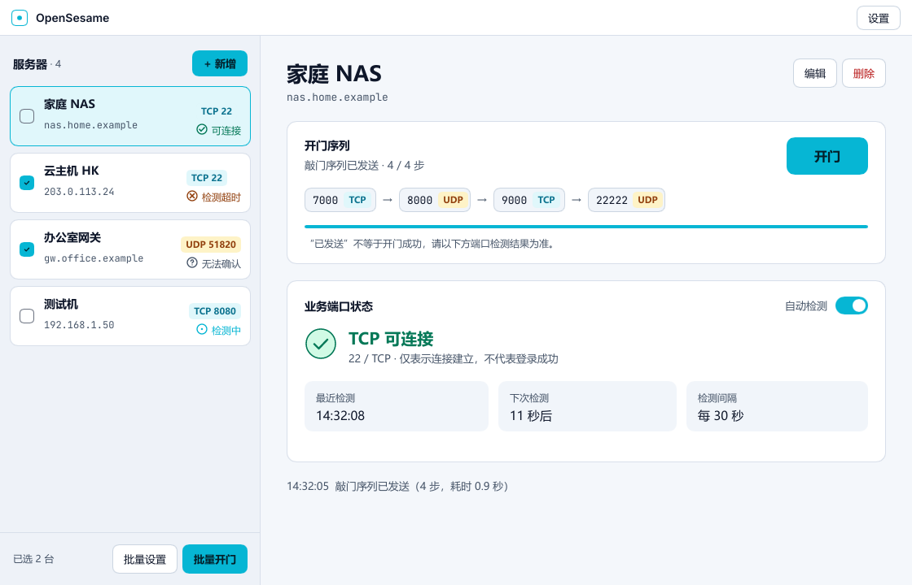
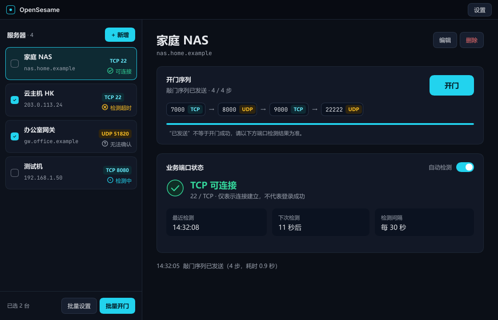
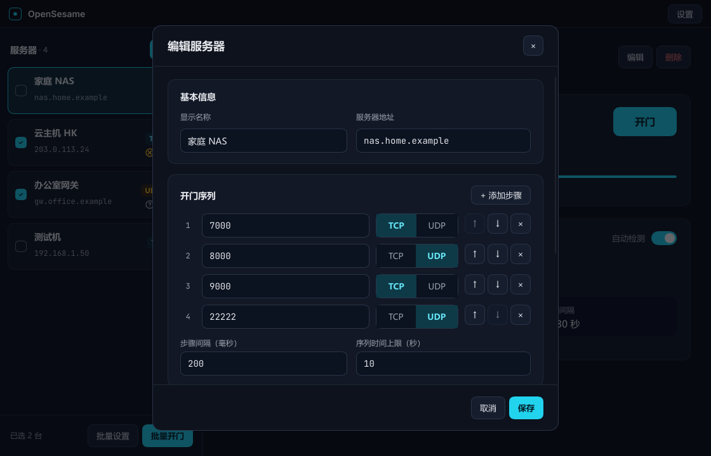
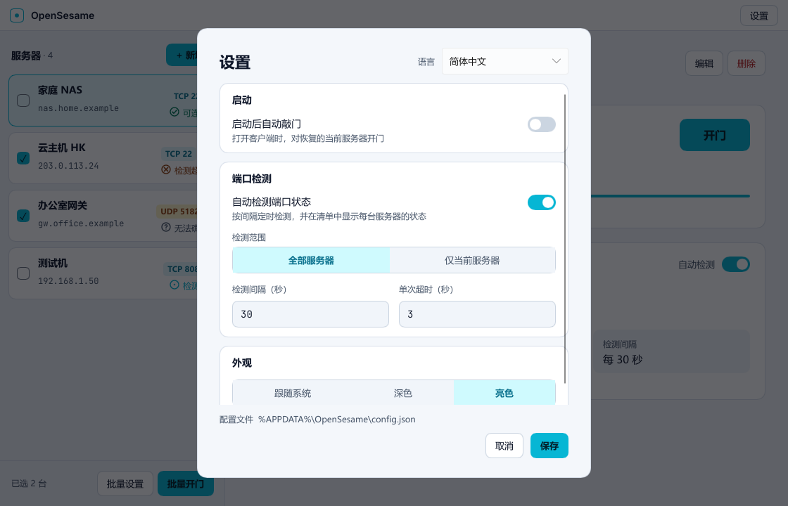
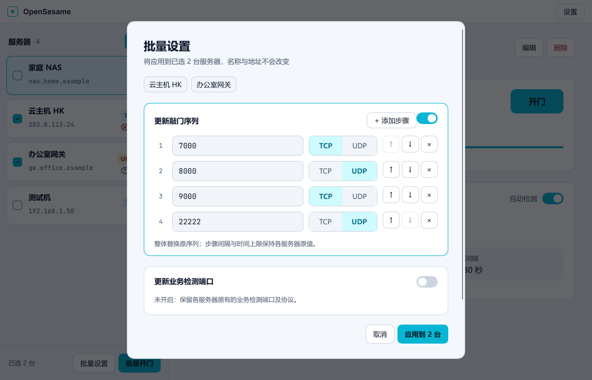
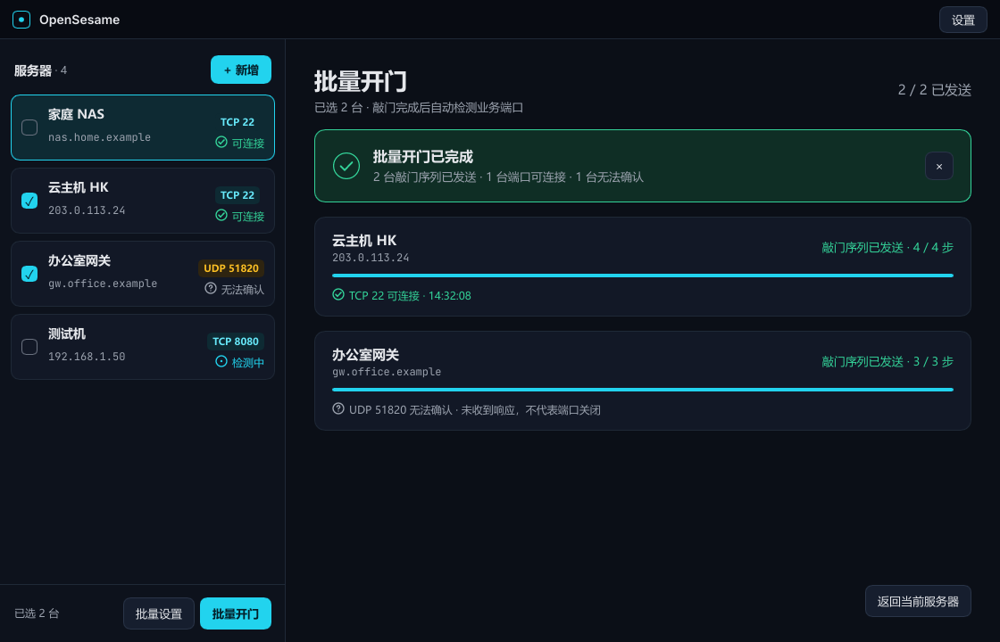

# OpenSesame

跨平台通用端口敲门客户端。管理多台服务器，按 TCP / UDP 序列开门，持续查看业务端口状态。

[快速开始](#快速开始) · [文档中心](docs/README.md) · [配置参考](docs/configuration.md) · [下载版本](https://github.com/Qwerto107/OpenSesame/releases)

**Rust + Slint** · **TCP / UDP** · **Windows / Linux / macOS**

各平台原生应用，无需安装 WebView2 或 .NET。配置按系统规范保存在当前用户目录。

---

## 界面一览

服务器清单、开门序列和业务端口状态集中展示，支持浅色、深色与跟随系统。

<strong>查看更多：深色主题、服务器编辑、设置与批量操作</strong>

截图来自当前开发版，使用独立演示数据，不包含真实服务器配置。正式版功能以对应[更新记录](docs/changelog.md)为准。

## 功能

| 能力 | 使用方式 |
| --- | --- |
| 多服务器管理 | 为每台服务器保存地址、敲门序列、业务端口和检测时间 |
| TCP / UDP 敲门 | 按顺序发送同协议或混合协议序列，配置步骤间隔与总时限 |
| 单台与批量开门 | 操作当前服务器，或勾选多台并查看批量进度和结果 |
| 持续状态检测 | 启动后按周期检测全部或当前服务器，开门后立即检测一次 |
| 启动自动开门 | 可选开启，作用于上次选中的服务器 |
| 独立批量设置 | 单独替换敲门序列或业务端口，也可同时修改 |
| 外观与语言 | 浅色、深色、跟随系统；简体中文、English、跟随系统 |
| 本地配置 | 按平台保存至用户配置目录，详见[配置参考](docs/configuration.md) |

## 快速开始

1. 从 [Releases](https://github.com/Qwerto107/OpenSesame/releases) 下载对应平台的发行包；Windows 运行 `OpenSesame.exe`，Linux 运行 `OpenSesame`，macOS 打开 `OpenSesame.app`。若尚未发布版本，可按[开发指南](docs/development.md)从源码构建。
2. 点击“新增”，填写名称、IP 或域名、服务端对应的开门序列，以及需要检测的业务端口。
3. 保存并点击“开门”，查看业务端口的检测结果。自动检测、启动自动开门和检测周期可在“设置”中调整。

下载校验及运行要求见[二进制说明](docs/binary.md)，完整操作见[使用指南](docs/usage.md)。

初次接触端口敲门，可先阅读 [knockd 工作机制](docs/usage.md#knockd-工作机制)，了解客户端发送序列、服务端放行和业务端口检测的关系。

## 支持范围

- 目标为 Windows 10 / 11 x64、Linux x64 / ARM64、macOS Intel / Apple Silicon。新增平台以对应 Actions 和实机验证结果为准。
- Linux 需要桌面图形库；macOS 测试包使用临时签名，尚未进行 Developer ID 签名、公证。详见[运行要求](docs/deployment.md#运行要求)。
- 当前提供开门操作；关门序列尚未提供。
- TCP 敲门使用普通套接字发送 SYN，建议服务端 knockd 配置 `TCPFlags = syn`；不提供自定义 TCP 标志或原始报文编辑。
- TCP“可连接”只表示连接建立。UDP 使用空数据报探测，无响应显示“无法确认”，不能据此判断端口关闭。
- 客户端不修改服务端规则。序列、协议、间隔和服务端允许的来源地址需要相互匹配。

## 文档导航

| 内容 | 文档 |
| --- | --- |
| 操作、自动检测与批量设置 | [使用指南](docs/usage.md) |
| 安装、备份、升级与故障排查 | [部署指南](docs/deployment.md) |
| 下载、校验和发行文件 | [二进制说明](docs/binary.md) |
| 配置字段与默认行为 | [配置参考](docs/configuration.md) |
| 本地开发、构建和验证 | [开发指南](docs/development.md) |
| Actions、构建产物与版本发布 | [发布流程](docs/releasing.md) |
| 版本变化 | [更新记录](docs/changelog.md) |
